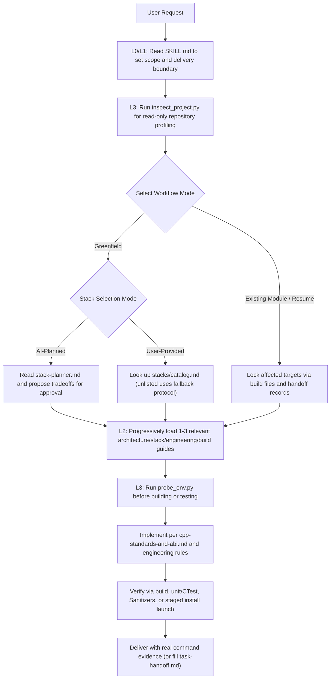

# `cpp-fullstack-dev` — C++ Full-Stack Agent Skill

[中文](README.md) | **English**

A modular C++ full-stack Agent Skill built on a three-layer progressive disclosure architecture: **Entry Orchestration (L0/L1) + Orthogonal Topic Guides (L2) + Zero-Dependency Deterministic Scripts (L3)**.

## Key Capabilities

- **Three Full-Stack Topologies (plus Pure C++ Core & Services)**:
  - **C++ + Web**: C++ HTTP/WebSocket backend + OpenAPI contract + React/Vue/TypeScript frontend ([Architecture Guide](references/architectures/cpp-web.md))
  - **C++ + Qt**: Qt5/Qt6 (Widgets / Quick / legacy qmake) desktop client + local SQLite or remote APIs ([Architecture Guide](references/architectures/cpp-qt.md))
  - **C++ + Python**: In-process native extensions (`nanobind` / `pybind11` / C ABI) or out-of-process services (`gRPC` / HTTP) ([Architecture Guide](references/architectures/cpp-python.md))
- **Dual Stack Acquisition & 22 Stack Reference Guides**:
  - **User-Provided Stack**: Detects or honors user-specified libraries directly. The [Stack Reference Catalog](references/stacks/catalog.md) covers 22 high-signal guides (Qt / Dear ImGui, Drogon / Crow / Oat++ / cpp-httplib / Boost.Asio & Beast, gRPC / ZeroMQ / MQTT / AMQP, SQLite / PostgreSQL / MySQL / Redis / DuckDB & Arrow, JSON / fmt / CLI11 / OpenSSL / Eigen / OpenCV, Web & Python FastAPI companion stacks, GoogleTest / Catch2 / Google Benchmark, and observability/security). Unlisted libraries follow the fallback protocol without overriding user choices.
  - **AI-Planned Stack**: Anchors 4 decision axes first, presents a recommended stack plus an alternative with explicit tradeoffs, and scaffolds only after user confirmation ([Stack Planner](references/workflow/stack-planner.md)).
- **Core C++ Engineering & Architecture Discipline**: Enforces [Concurrency](references/engineering/concurrency.md), [Networking](references/engineering/networking.md), [Generics & Templates](references/engineering/generics.md), and [Project Management, Low-Coupling Architecture & Design Patterns](references/engineering/architecture-and-project-management.md) for extensible, maintainable deliverables.
- **Customizable UI Theme System**: Bundles 5 curated `DESIGN.md` presets (`linear` / `cursor` / `notion` / `vercel` / `stripe`) plus a `native` OS-following mode, with both project-level and skill-level custom theme extension hooks ([Theme Index](references/ui/themes/index.md) · [Custom Theme Interface](references/ui/themes/custom-interface.md)).
- **Repo Facts First & Evidence-Based Delivery**: Probes real build configs and local toolchains before acting, and reports actual commands, exit codes, and verified artifacts ([Verification & Quality Gates](references/workflow/verification-and-quality.md)).

---

## Skill Execution Workflow



### Step-by-Step Walkthrough

1. **Inspect Project & Route Mode**: On entry, the agent runs [`inspect_project.py`](scripts/inspect_project.py) in read-only mode to detect `CMakeLists.txt`, `CMakePresets.json`, `vcpkg.json`, `.pro`/`.pri`, `pyproject.toml`, `package.json`, `.proto`, OpenAPI specs, custom `DESIGN.md` files, and optional `cpp-stack.json`, then routes to Greenfield, Existing Module, or Resume per [Modes & Routing](references/workflow/modes-and-routing.md).
2. **Determine Architecture & Stack**:
   - **User-Provided**: Maps detected or requested libraries via [Stack Reference Catalog](references/stacks/catalog.md), honoring project reality for any unlisted stack.
   - **AI-Planned**: Uses [Stack Planner](references/workflow/stack-planner.md) to propose a primary stack, alternative, and tradeoff summary before creating files.
3. **Progressive Knowledge Loading (L2)**: Reads only the 1–3 reference docs relevant to the active task via the [SKILL.md](SKILL.md) routing table.
4. **Probe Environment & Implement**: Runs [`probe_env.py`](scripts/probe_env.py) to locate local compilers (including Windows `vcvars64.bat`), CMake, vcpkg, Qt/qmake, Node, and Python tools, then implements following [C++ Standards & ABI](references/workflow/cpp-standards-and-abi.md) and `references/engineering/`.
5. **Evidence-Based Verification & Handoff**: Executes builds, tests (`GoogleTest` / `Catch2` / `Qt Test` / `pytest` / `CTest`), Sanitizers, or clean staging-tree launches per [Verification & Quality Gates](references/workflow/verification-and-quality.md); uses [Task Handoff Template](assets/templates/task-handoff.md) when handing off across sessions.

---

## Installation & Activation

Copy or clone this repository into your coding agent's skills directory:

| Agent Platform | Recommended Path | Activation |
| --- | --- | --- |
| **Codex CLI / IDE** | `~/.codex/skills/cpp-fullstack-dev` | Mention `$cpp-fullstack-dev` or trigger via task description |
| **Antigravity** | Project `.agents/skills/cpp-fullstack-dev` or global `~/.gemini/config/skills/cpp-fullstack-dev` | Auto-matched by description or explicitly requested |
| **Claude Code** | Project `.claude/skills/cpp-fullstack-dev` or `~/.claude/skills/cpp-fullstack-dev` | `/cpp-fullstack-dev` or auto-matched by task description |

---

## Directory Layout

```text
cpp-fullstack-dev/
├── .gitignore                           # Ignores Python bytecode caches and editor temp files
├── VERSION                              # Semantic version of this skill
├── SKILL.md                             # L0/L1: Trigger metadata, 5-step workflow, routing table
├── README.md                            # Chinese documentation
├── README.en.md                         # This English documentation
├── agents/
│   └── openai.yaml                      # Cross-platform agent metadata
├── scripts/                             # L3: Zero-dependency Python 3 scripts
│   ├── inspect_project.py               # Read-only repo profiler + cpp-stack.json validator
│   ├── probe_env.py                     # Read-only local toolchain & runtime probe
│   ├── extract_theme.py                 # Read-only compact token extractor for DESIGN.md / theme.json
│   └── validate_skill.py                # Skill self-check (links, JSON/Schema, catalog, syntax, tests)
├── tests/
│   └── test_skill_scripts.py            # Zero-dependency regression unit tests for scripts
├── assets/
│   ├── schemas/
│   │   └── cpp-stack.schema.json        # Formal JSON Schema for optional cpp-stack.json
│   └── templates/                       # Ready-to-use project & spec templates
│       ├── .clang-format                # Aligned with C++ formatting rules
│       ├── .clang-tidy                  # Static analysis & identifier naming checks
│       ├── .editorconfig                # Cross-language (C++/Web/Python) indentation & UTF-8 baseline
│       ├── CMakeLists.txt               # Modern C++20 starter with export headers, warnings & RPATH
│       ├── CMakePresets.json            # Win Ninja+MSVC / VS2022 / Linux(+ASan) / macOS presets
│       ├── vcpkg.json                   # vcpkg manifest starter
│       ├── cpp-stack.json               # Optional component routing starter
│       ├── DESIGN.md                    # Custom UI theme starter
│       ├── stack-spec.md                # Template for adding new stack guides
│       └── task-handoff.md              # Cross-session handoff template
└── references/                          # L2: Orthogonal, deduplicated reference guides
    ├── workflow/                        # Modes, AI stack planner, C++ ABI standards, quality gates
    ├── engineering/                     # Concurrency, networking, generics, architecture & patterns
    ├── architectures/                   # cpp-web / cpp-qt / cpp-python integration guides
    ├── build/                           # CMake+vcpkg+CTest, qmake/Conan/Meson, Win/Linux/macOS deploy
    ├── stacks/                          # 22 stack guides (Qt/ImGui/Drogon/Asio/gRPC/DB/Web/Python/Test)
    └── ui/                              # UI states, layout patterns & themes (Presets + Custom)
```

---

## Quick-Start Examples

- **AI-Planned Greenfield Project**
  > "Use `$cpp-fullstack-dev` to design a C++ backend + Vue dashboard log analyzer from scratch; propose the stack options and tradeoffs first."
- **User-Provided Stack / Legacy Codebase**
  > "Use `$cpp-fullstack-dev` to inspect this Qt5 qmake app, fix stale async results overwriting the detail pane on item switch, and verify."
- **Built-in or Custom `DESIGN.md` Theme**
  > "Use `$cpp-fullstack-dev` to implement the desktop settings view matching `docs/DESIGN.md` (or the built-in `linear` preset)."

---

## Extension & Customization

### 1. Custom UI Themes
See [Custom Theme Interface](references/ui/themes/custom-interface.md) for full resolution precedence and token mapping:
- **Project-Level Theme (Recommended)**: Copy the [DESIGN.md Template](assets/templates/DESIGN.md) to `DESIGN.md` or `docs/DESIGN.md` in your target repository (or point `ui.theme.source` in `cpp-stack.json` to it).
- **Skill-Level Reusable Theme**: Place `<theme-id>/DESIGN.md` under [`references/ui/themes/custom/`](references/ui/themes/custom/README.md) to reuse across projects.

### 2. Adding Libraries to the Stack Catalog
1. Copy the [stack-spec.md Template](assets/templates/stack-spec.md) to `references/stacks/<stack-id>.md`.
2. Register the entry and relative link in [catalog.md](references/stacks/catalog.md).
3. `inspect_project.py` auto-discovers slugs from `references/stacks/*.md`; optionally add package/CMake aliases to `CATALOG_ALIASES` in [`scripts/inspect_project.py`](scripts/inspect_project.py).
4. Run `python scripts/validate_skill.py` to verify links, catalog coverage, alias sync, and script unit tests.

### 3. Optional `cpp-stack.json` Onboarding
Most repositories do not need `cpp-stack.json`. For large multi-component repos that want explicit component boundaries, `dependsOn` graphs, or window theme mappings, start from [cpp-stack.json](assets/templates/cpp-stack.json) and [cpp-stack.schema.json](assets/schemas/cpp-stack.schema.json), and validate anytime via `inspect_project.py`.

---

## Built-In CLI Scripts

> When invoking from a target repository, use `<skill_dir>/scripts/...` where `<skill_dir>` is this Skill's root directory (use `python3` on Linux/macOS).

| Script | Command | Purpose |
| --- | --- | --- |
| Project Inspector | `python <skill_dir>/scripts/inspect_project.py [project_root]` | Detect build systems, packages, interfaces, custom themes, and validate `cpp-stack.json` |
| Environment Probe | `python <skill_dir>/scripts/probe_env.py` | Probe compilers (incl. Windows `vcvars64.bat`), CMake, vcpkg, Qt, Node, and Python tools |
| Theme Token Extractor | `python <skill_dir>/scripts/extract_theme.py <preset\|path\|--list>` | Extract compact semantic tokens, CSS variables, spacing, and radii from `DESIGN.md` / `theme.json` |
| Skill Self-Check | `python <skill_dir>/scripts/validate_skill.py` | Verify frontmatter, relative Markdown links, JSON/Schema, catalog coverage, syntax, and run unit tests |

> Pass `--compact` to `inspect_project.py`, `probe_env.py`, or `extract_theme.py` for single-line JSON output.

---

## License Attribution

- The 5 curated `DESIGN.md` presets under `references/ui/themes/presets/` originate from `VoltAgent/awesome-design-md`; see [presets/LICENSE](references/ui/themes/presets/LICENSE).
