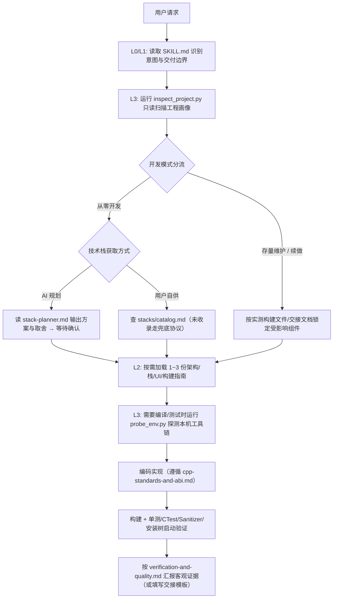

# `cpp-fullstack-dev` — C++ 全栈开发 Agent Skill

**中文** | [English](README.en.md)

面向 AI Coding Agent 的模块化 C++ 全栈开发 Skill，采用「**入口编排（L0/L1） + 正交专题参考（L2） + 零依赖确定性脚本（L3）**」三层渐进披露架构。

## 核心能力

- **三种全栈形态（外加纯 C++ 核心/后端）**：
  - **C++ + Web**：C++ HTTP/WS 后端 + OpenAPI 契约 + React/Vue/TypeScript 前端（[架构指南](references/architectures/cpp-web.md)）
  - **C++ + Qt**：Qt5/Qt6（Widgets / Quick / 存量 qmake）桌面端 + 本地 SQLite 或远端服务（[架构指南](references/architectures/cpp-qt.md)）
  - **C++ + Python**：同进程绑定（`nanobind` / `pybind11` / C ABI）或跨进程服务（`gRPC` / HTTP）（[架构指南](references/architectures/cpp-python.md)）
- **双模式技术栈获取与 22 份参考仓库**：
  - **用户自供技术栈**：直接识别或遵从用户指定库；[技术栈规范仓库](references/stacks/catalog.md)内置 22 份高频规范（覆盖 Qt / Dear ImGui、Drogon / Crow / Oat++ / cpp-httplib / Boost.Asio & Beast、gRPC / ZeroMQ / MQTT / AMQP、SQLite / PostgreSQL / MySQL / Redis / DuckDB & Arrow、JSON / fmt / CLI11 / OpenSSL / Eigen / OpenCV、Web 前端与 Python FastAPI 协作栈、GoogleTest / Catch2 / Benchmark 等），未收录库走「兜底协议」，**不擅自替换用户选型**。
  - **AI 协助规划技术栈**：先结合需求锚定 4 个维度，再给出推荐栈 + 备选方案与取舍边界，经用户确认后脚手架落地（[规划指南](references/workflow/stack-planner.md)）。
- **可自定义 UI 主题系统**：内置 5 套精选 `DESIGN.md` 预设（`linear` / `cursor` / `notion` / `vercel` / `stripe`）与原生 `native` 模式，并预留项目级与 Skill 级自定义主题接口（[主题总览](references/ui/themes/index.md) · [自定义接口](references/ui/themes/custom-interface.md)）。
- **工程质量与架构治理**：内置 [并发编程](references/engineering/concurrency.md)、[网络编程](references/engineering/networking.md)、[泛型与模板](references/engineering/generics.md) 及 [项目管理与设计模式](references/engineering/architecture-and-project-management.md) 规范，约束模块化、低耦合、可扩展与可读性。
- **工程事实优先与强证据交付**：不靠模型猜测构建配置或口头声称通过，构建与测试前由脚本探测真实仓库与本机工具链，交付必附真实命令与退出码（[验证与质量门禁](references/workflow/verification-and-quality.md)）。

---

## Skill 运行全流程



### 五步执行说明

1. **探测工程与模式分流**：Agent 启动后首先在目标工程只读执行 [`inspect_project.py`](scripts/inspect_project.py)，自动解析 `CMakeLists.txt`、`CMakePresets.json`、`vcpkg.json`、`.pro`/`.pri`、`pyproject.toml`、`package.json`、`.proto`、OpenAPI、自定义 `DESIGN.md` 及可选的 `cpp-stack.json`，据此依据 [模式与路由](references/workflow/modes-and-routing.md) 分流为「从零开发 / 存量维护 / 续做」。
2. **确定架构与技术栈**：
   - **用户自供**：查阅 [技术栈规范仓库](references/stacks/catalog.md)，命中则按需加载对应规范；未命中则沿用项目真实配置与源码边界。
   - **AI 规划**：读取 [技术栈规划指南](references/workflow/stack-planner.md)，输出推荐组合、备选方案与取舍说明，确认后再创建模板与目录。
3. **渐进式按需加载（L2）**：从 [SKILL.md](SKILL.md) 速查表仅加载当前任务直接涉及的 1~3 份文档，不一次性通读无关目录。
4. **工具链探测与编码实现**：需要编译或测试前运行 [`probe_env.py`](scripts/probe_env.py) 识别本机编译器（含 Windows `vcvars64.bat` 路径）、CMake、vcpkg、Qt/qmake、Node 与 Python 工具；编码与跨库边界遵守 [C++ 规范与 ABI](references/workflow/cpp-standards-and-abi.md)。
5. **基于证据的交付与续做交接**：按 [验证与质量门禁](references/workflow/verification-and-quality.md) 执行编译、测试（GoogleTest / Qt Test / pytest / CTest）及必要时的 Sanitizer 或安装树启动检查；跨会话续做时使用 [任务交接模板](assets/templates/task-handoff.md)。

---

## 安装与启用

将本仓库复制到对应 Agent 平台的 Skills 目录即可生效：

| 平台 | 推荐放置路径 | 触发方式 |
| --- | --- | --- |
| **Codex CLI / IDE** | `~/.codex/skills/cpp-fullstack-dev` | 对话中显式提及 `$cpp-fullstack-dev` 或匹配描述自动触发 |
| **Antigravity** | 项目级 `.agents/skills/cpp-fullstack-dev` 或全局 `~/.gemini/config/skills/cpp-fullstack-dev` | 匹配描述自动加载，或直接指示使用 `cpp-fullstack-dev` |
| **Claude Code** | 项目级 `.claude/skills/cpp-fullstack-dev` 或 `~/.claude/skills/cpp-fullstack-dev` | `/cpp-fullstack-dev` 或匹配任务描述自动加载 |

---

## 目录结构

```text
cpp-fullstack-dev/
├── .gitignore                           # 忽略 Python 缓存与编辑器临时文件
├── VERSION                              # Skill 语义版本号
├── SKILL.md                             # L0/L1：触发描述、5 步执行流与速查路由表
├── README.md                            # 本说明文档
├── README.en.md                         # 英文说明文档
├── agents/
│   └── openai.yaml                      # 多 Agent 平台元数据兼容入口
├── scripts/                             # L3：Python 3 标准库零依赖脚本
│   ├── inspect_project.py               # 只读扫描工程画像 + 校验可选 cpp-stack.json
│   ├── probe_env.py                     # 只读探测本机编译器、CMake、vcpkg、Qt、Node、Python
│   ├── extract_theme.py                 # 只读提取预设/自定义 DESIGN.md 精简语义 Token JSON
│   └── validate_skill.py                # Skill 自检（Frontmatter、死链、JSON、索引、语法与单测）
├── tests/
│   └── test_skill_scripts.py            # 零依赖脚本回归单元测试
├── assets/
│   ├── schemas/
│   │   └── cpp-stack.schema.json        # cpp-stack.json 正式 JSON Schema
│   └── templates/                       # 开箱即用的工程起点模板
│       ├── .clang-format                # 与 C++ 格式规范严格对齐
│       ├── .clang-tidy                  # 静态检查与命名规范校验（对齐 cpp-standards-and-abi.md）
│       ├── .editorconfig                # 跨 C++/Web/Python 编辑器缩进与编码基线
│       ├── CMakeLists.txt               # C++20 导出宏、编译警告与安装 RPATH 起点模板
│       ├── CMakePresets.json            # Win Ninja+MSVC / VS2022 / Linux(+ASan) / macOS 预设
│       ├── vcpkg.json                   # vcpkg manifest 模板
│       ├── cpp-stack.json               # 可选多组件路由起点模板
│       ├── DESIGN.md                    # 用户自定义主题模板
│       ├── stack-spec.md                # 扩展技术栈规范模板
│       └── task-handoff.md              # 跨会话任务交接模板
└── references/                          # L2：正交、无重复专题指南
    ├── workflow/                        # 开发模式、AI 选型规划、C++ ABI 规范、质量门禁
    ├── engineering/                     # 并发、网络、泛型模板及低耦合架构/项目管理/设计模式
    ├── architectures/                   # cpp-web / cpp-qt / cpp-python 三端全栈集成约束
    ├── build/                           # CMake+vcpkg+CTest、qmake/Conan/Meson 及 Win/Linux/macOS 部署
    ├── stacks/                          # 22 份技术栈规范仓库（Qt/ImGui/Drogon/Crow/Asio/gRPC/ZMQ/SQLite/PG/MySQL/Redis/DuckDB/JSON/Eigen/OpenCV/Web/Python/测试/日志安全）
    └── ui/                              # UI 交互四态、布局模式及主题系统（Presets + Custom 接口）
```

---

## 快速上手示例

- **场景 1：AI 协助规划新项目**
  > “使用 `$cpp-fullstack-dev` 帮我从零规划一个 C++ 后端 + Vue 管理台的日志分析工具，先给出技术栈选型方案和取舍。”
  （Agent 将运行 `probe_env.py` 并按 `stack-planner.md` 与 `cpp-web.md` 输出方案等待确认。）

- **场景 2：接手用户自供技术栈 / 存量工程**
  > “用 `$cpp-fullstack-dev` 检查当前 Qt5 qmake 工程，修复异步加载切换条目时旧结果覆盖详情页的问题并验证。”
  （Agent 将先运行 `inspect_project.py` 识别 `.pro` 与模块依赖，再加载 `cpp-qt.md`、`qt-widgets.md`、`legacy-and-alt-builds.md`。）

- **场景 3：使用内置或自定义 `DESIGN.md` 主题**
  > “使用 `$cpp-fullstack-dev` 按仓库里的 `docs/DESIGN.md`（或内置 `linear` 风格）实现桌面设置窗口。”
  （Agent 将依据 [自定义主题接口](references/ui/themes/custom-interface.md) 提取 Token 并映射至 Qt/Web 样式。）

---

## 扩展与自定义指南

### 1. 接入自定义 UI 主题
详细优先级与 Token 映射见 [自定义主题扩展接口](references/ui/themes/custom-interface.md)：
- **项目级主题（推荐）**：复制 [DESIGN.md 模板](assets/templates/DESIGN.md) 到目标仓库根目录的 `DESIGN.md` 或 `docs/DESIGN.md`（也可在 `cpp-stack.json` 的 `ui.theme.source` 显式指向）。
- **Skill 级可复用主题**：在 [`references/ui/themes/custom/`](references/ui/themes/custom/README.md) 下新建 `<theme-id>/DESIGN.md`，即可通过 `<theme-id>` 跨项目复用。

### 2. 向规范仓库扩充新技术栈
1. 复制 [stack-spec.md 模板](assets/templates/stack-spec.md) 到 `references/stacks/<stack-id>.md`。
2. 在 [catalog.md](references/stacks/catalog.md) 的清单表格中登记该标识与相对链接。
3. `inspect_project.py` 会自动扫描 `references/stacks/*.md` 发现 `<stack-id>`；若需自动识别第三方包名或 CMake target，可按需将别名补充到 [`scripts/inspect_project.py`](scripts/inspect_project.py) 的 `CATALOG_ALIASES`。
4. 运行 `python scripts/validate_skill.py` 确认索引、链接、别名同步与脚本单测校验通过。

### 3. 可选接入 `cpp-stack.json`
绝大多数项目无需手动维护 `cpp-stack.json`；仅当多组件仓库需要显式固化组件职责、`dependsOn` 依赖图或窗口主题映射时，可基于 [模板](assets/templates/cpp-stack.json) 与 [Schema](assets/schemas/cpp-stack.schema.json) 在项目根目录生成，并随时用 `inspect_project.py` 检查环依赖与路径合法性。

---

## 内置脚本命令速查

> 在业务仓库内调用时请使用 `<skill_dir>/scripts/...`（`<skill_dir>` 为本 Skill 根目录；Linux/macOS 请使用 `python3`）。

| 脚本 | 常用命令 | 用途 |
| --- | --- | --- |
| 工程只读分析 | `python <skill_dir>/scripts/inspect_project.py [project_root]` | 识别构建系统、依赖、接口、自定义主题与校验 `cpp-stack.json` |
| 环境工具链探测 | `python <skill_dir>/scripts/probe_env.py` | 探测编译器（含 Windows `vcvars64.bat`）、CMake、vcpkg、Qt、Node、Python |
| 主题 Token 提取 | `python <skill_dir>/scripts/extract_theme.py <preset\|path\|--list>` | 提取预设或自定义 `DESIGN.md` / `theme.json` 的精简语义色板、CSS 变量与字距 |
| Skill 自检 | `python <skill_dir>/scripts/validate_skill.py` | 检查 Frontmatter、Markdown 死链、JSON/Schema、目录索引、Python 语法并运行单元测试 |

> 支持传入 `--compact` 给 `inspect_project.py`、`probe_env.py` 或 `extract_theme.py` 输出单行压缩 JSON。

---

## 许可说明

- `references/ui/themes/presets/` 下的 5 份精选 `DESIGN.md` 源自 `VoltAgent/awesome-design-md`，所附许可协议见 [presets/LICENSE](references/ui/themes/presets/LICENSE)。
